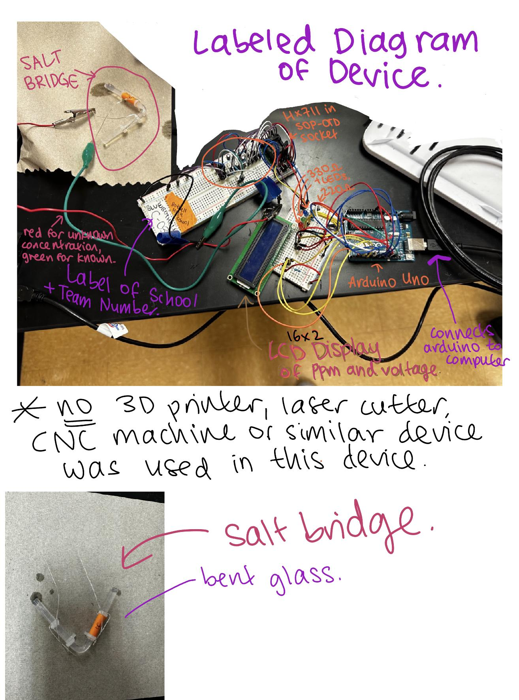
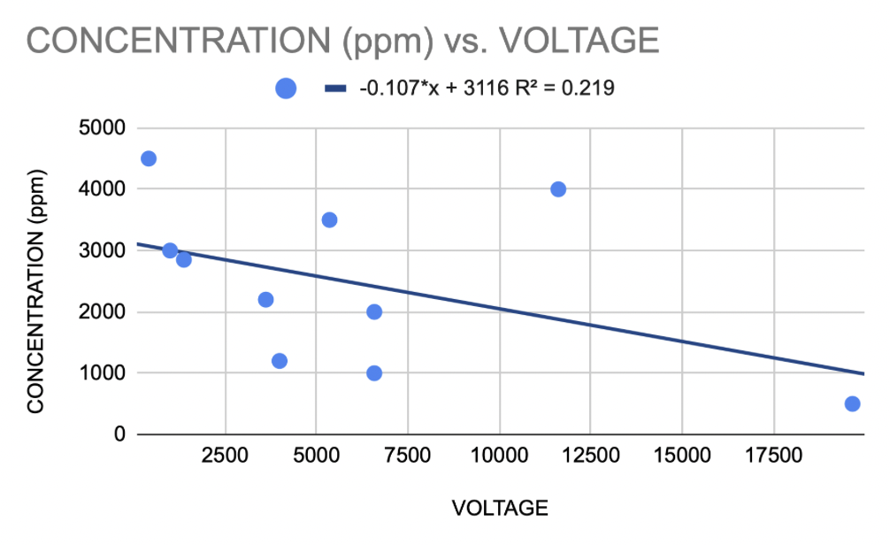
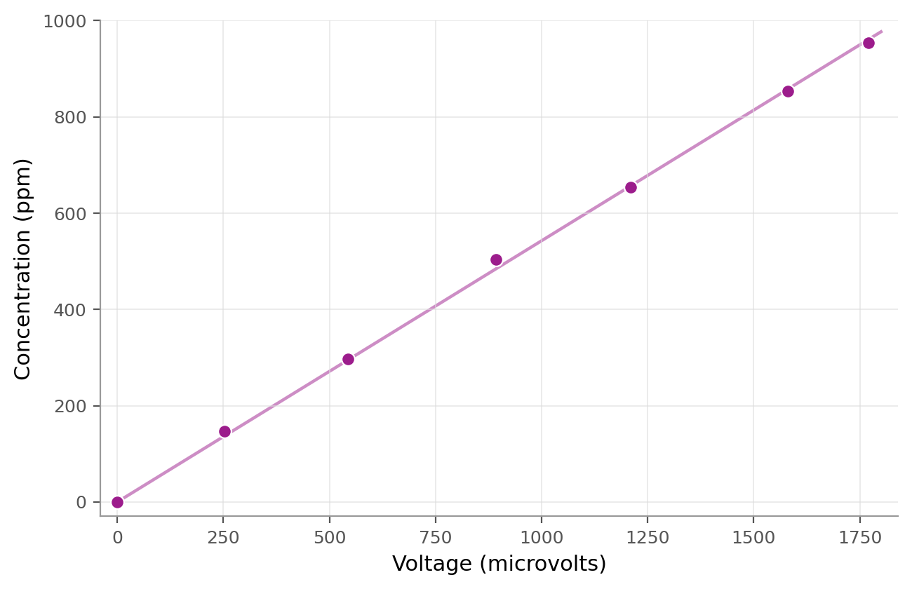
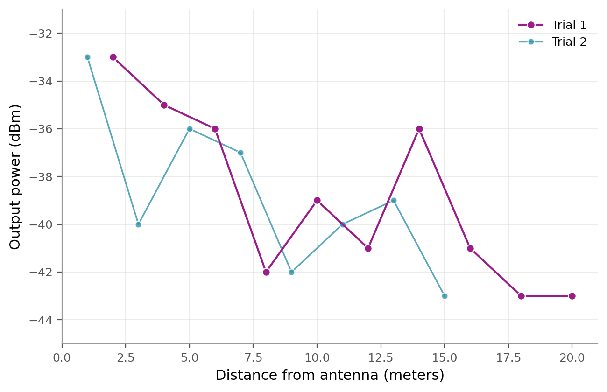

These are build diaries from the Science Olympiad events where I made hardware. Over the 2022 to 2024 seasons I worked on Detector Building, Robot Tour, and a Division C Tower build. The detector is the one I have the most to say about, so it comes first and takes up most of the space. The others I am writing down from the files I still have, and where a file does not tell me something, I say so.

## Detector Building, water salinity

For Science Olympiad Detector Building, the event hands you a measurable quantity and asks you to build something that reads it. The year my partner Nathan Chiu and I competed, the quantity was water salinity, the concentration of dissolved salt in a sample. We had to design a device that took in an unknown water sample and reported its salinity, built from parts we could wire ourselves. The rules banned 3D printers, laser cutters, and CNC machines, so everything sat on a wooden board we held together with epoxy.

We competed under Bothell High School and built the device across the 2022 to 2024 seasons. We placed 1st at every regional and state competition we entered, and **we won the MIT national invitational in 2024.**

### How it reads salt from a voltage

The core of the device is a salt bridge. I bent a piece of glass tubing into a U, filled it with agar that held dissolved potassium chloride, and set each end into a different cup of water. One cup holds a reference solution whose salinity I already know. The other holds the unknown sample. **The salt bridge lets ions move between the two solutions without letting the liquids mix**, which closes an electrical circuit between them.

Two solutions of different salt concentration, connected this way, behave like a weak battery, a concentration cell. The bigger the difference in concentration, the larger the voltage that builds across the bridge. That voltage is what we measure. The Nernst equation ties the two together, and it says the cell voltage grows with the logarithm of the ratio of the two concentrations. A small voltage near zero means the sample sits close to the reference, and a growing voltage means it sits far from it.

A wire runs from each end of the salt bridge to the electronics. From there the device reads a very small voltage and turns it into a salinity number on a screen.

<figure style="color: var(--ink); margin: 48px 0 12px;">
  <svg viewBox="0 0 820 230" width="100%" role="img" aria-label="Signal path from the salt bridge to the screen: the concentration cell produces microvolts, the HX711 amplifies them, the Arduino converts the reading to parts per million, and the LCD and LEDs display it.">
    <style>
      .sd-box { fill: none; stroke: currentColor; stroke-width: 1.6; }
      .sd-wire { stroke: var(--accent); stroke-width: 2; fill: none; }
      .sd-head { fill: var(--accent); }
      .sd-cup { fill: var(--accent-soft); stroke: var(--accent); stroke-width: 1.3; }
      .sd-bridge { fill: none; stroke: var(--accent); stroke-width: 2; }
      .sd-lbl { fill: currentColor; font-family: var(--sans), sans-serif; }
      .sd-sub { fill: var(--muted); font-family: var(--mono), monospace; font-size: 10px; }
    </style>
    <defs>
      <marker id="sd-arrow" markerWidth="9" markerHeight="9" refX="7" refY="4" orient="auto">
        <path class="sd-head" d="M0,0 L8,4 L0,8 Z"></path>
      </marker>
    </defs>
    <g class="sd-box">
      <rect x="18" y="56" width="168" height="92" rx="10"></rect>
      <rect x="246" y="56" width="168" height="92" rx="10"></rect>
      <rect x="474" y="56" width="150" height="92" rx="10"></rect>
      <rect x="684" y="56" width="120" height="92" rx="10"></rect>
    </g>
    <g class="sd-wire" marker-end="url(#sd-arrow)">
      <line x1="188" y1="102" x2="242" y2="102"></line>
      <line x1="416" y1="102" x2="470" y2="102"></line>
      <line x1="626" y1="102" x2="680" y2="102"></line>
    </g>
    <rect class="sd-cup" x="40" y="96" width="36" height="34"></rect>
    <rect class="sd-cup" x="128" y="96" width="36" height="34"></rect>
    <path class="sd-bridge" d="M58,96 C58,74 146,74 146,96"></path>
    <g class="sd-lbl" text-anchor="middle">
      <text x="102" y="48" font-size="13" font-weight="600">salt bridge</text>
      <text x="102" y="146" font-size="10.5">concentration cell</text>
      <text x="330" y="48" font-size="13" font-weight="600">HX711</text>
      <text x="330" y="100" font-size="11">24-bit ADC</text>
      <text x="330" y="118" font-size="11">amplifies microvolts</text>
      <text x="549" y="48" font-size="13" font-weight="600">Arduino Uno</text>
      <text x="549" y="108" font-size="11">counts to ppm</text>
      <text x="744" y="48" font-size="13" font-weight="600">LCD + LEDs</text>
      <text x="744" y="108" font-size="11">voltage, ppm</text>
    </g>
    <g class="sd-sub" text-anchor="middle">
      <text x="215" y="94">microvolts</text>
      <text x="443" y="94">digital count</text>
      <text x="653" y="94">salinity</text>
    </g>
  </svg>
  <figcaption><strong>Figure 1.</strong> The signal path. Ions crossing the salt bridge build a microvolt-scale voltage, the HX711 amplifies it into a digital count, the Arduino converts that count to parts per million, and the LCD and indicator LEDs report the result.</figcaption>
</figure>

### The electronics

An Arduino Uno runs the device. It cannot read microvolt-level signals on its own, so the voltage across the salt bridge passes through an HX711, a 24-bit analog-to-digital converter that amplifies tiny voltages before the Arduino sees them. **The HX711 reads signals down in the microvolt range**, the scale a concentration cell produces. We seated the HX711 chip in a SOP-16-to-DIP-16 socket so it would sit on a breadboard, and the chip carries its own resistors and capacitors.

The Arduino drives a 16x2 LCD that prints the measured voltage on the top line and the salinity in parts per million on the bottom line. Three resistor-LED pairs give a quick color readout of which concentration band the sample falls into. We also ran a red lead and a green lead for the two cups, red for the unknown sample and green for the reference.

<figure>
  
  <figcaption><strong>Figure 2.</strong> Our labeled photo of the finished device. The bent-glass salt bridge sits at the upper left, the HX711 chip sits in a socket on the breadboard, and the Arduino Uno drives the 16x2 LCD and the indicator LEDs. We epoxied the whole build to a wooden board.</figcaption>
</figure>

Here is the main loop of the Arduino sketch. It averages ten readings from the HX711, holds the value steady when it drifts by less than half a percent to stop slow creep, converts the raw count to microvolts, and lights the LED for whichever band the reading falls in.

```cpp
#include "HX711.h"
#include "LiquidCrystal.h"

#define BLUE 10
#define GREEN 9
#define RED 8

LiquidCrystal lcd(12, 11, 5, 4, 3, 2);
const int DOUT1 = 6; const int SCK1 = 7; HX711 scale;

// concentration bands, in ppm, for the three indicator LEDs
const double b1 = 0.0;    const double b2 = 2000.0; // blue
const double g1 = 2000.0; const double g2 = 4000.0; // green
const double r1 = 4000.0; const double r2 = 5000.0; // red

void loop() {
  static long total = 0;
  static int times = 0;
  static double prevV = 0.0;

  double voltage = scale.get_value(10);              // average of 10 raw reads
  if (abs(voltage - prevV) < voltage / 200) voltage = prevV; // hold if < 0.5% change
  prevV = voltage;

  if (voltage > 50) {
    int v = scale.get_value(10);
    total += v / 4.5;                                // raw count to microvolts
    times += 1;
    long ppm = round(total / times * 1.0);

    lcd.setCursor(0, 0); lcd.print("Voltage:"); lcd.print(round(total / times)); lcd.print("uV");
    lcd.setCursor(0, 1); lcd.print("p:"); lcd.print(ppm); lcd.print("ppm");

    digitalWrite(BLUE,  (b1 < ppm && ppm < b2));
    digitalWrite(GREEN, (g1 < ppm && ppm < g2));
    digitalWrite(RED,   (r1 < ppm && ppm < r2));
  }
}
```

### Calibration

The wiring was quick. Most of the season went into turning the voltage readings into salinity numbers. A raw voltage means nothing until you know what concentration produced it, so we mixed samples at concentrations we knew, read the voltage for each one, and recorded the pairs. That table is the calibration.

Our early attempts were rough. On one of the first full calibration runs, ten samples gave a scatter that barely trended at all, and the line of best fit explained only about a fifth of the variation (R-squared near 0.22). The points sat in almost a cloud, which told us the device was picking up as much noise as signal.

<figure>
  
  <figcaption><strong>Figure 3.</strong> One of our early calibration runs. Ten known samples against measured voltage, with a line of best fit that captured almost none of the trend. Most of our season went into cleaning this up.</figcaption>
</figure>

Two changes fixed it. The HX711 averaging and the creep filter cut the jitter in each reading. Then I treated the sensor as a logarithmic device from the start, since the Nernst relationship is logarithmic, and fit concentration against the log of the voltage instead of the voltage itself. An earlier version of our code used a log fit directly, computing concentration roughly as a constant minus 633 times the natural log of the reading, with the exact coefficients shifting between versions.

By the end, a clean calibration sweep looked like this, with voltage in microvolts against the known concentration in ppm:

| Voltage (uV) | Concentration (ppm) |
| --- | --- |
| 0 | 0 |
| 252 | 147 |
| 544 | 297 |
| 893 | 504 |
| 1210 | 654 |
| 1580 | 854 |
| 1770 | 954 |

<figure>
  
  <figcaption><strong>Figure 4.</strong> The same device after the fixes. Seven known samples fall close to a straight line through the origin, a little more than half a ppm for every microvolt.</figcaption>
</figure>

Across the full sweep the relationship held close to a straight line through the origin. **1770 microvolts mapped to about 954 ppm**, a little more than half a ppm for every microvolt, and the intermediate points sat near that same slope. Turning that cloud of points into a line I could trust is the part of the project I am most proud of.

## WiFi Lab

WiFi Lab pairs a build with a written test. You make a directional antenna to push a signal as far as it will carry, and you answer questions on antenna and radio theory. I ran this event with my partner Shunzo Hida as team C-34, Bothell Blue. I took the antenna and theory side and Shunzo took the math.

Our build was the antenna and a way to read how strong its signal stayed as we moved away from it. We measured output power in dBm at set distances and logged it on the competition spec sheet, out to 20 meters, across two trials. **The power sat between about -33 and -43 dBm and fell off with distance, with a lot of scatter in the middle readings.**

<figure>
  
  <figcaption><strong>Figure 5.</strong> Output power against distance from our WiFi Lab antenna, taken from the competition spec sheet. Trial 1 covered the even distances from 2 to 20 meters and Trial 2 the odd distances. The signal weakened with distance, from about -33 dBm close in to around -43 dBm at the far end, with noisy middle readings.</figcaption>
</figure>

The spec sheet is the record I have. It does not list the antenna design, the season, or our placement, so [VERIFY the WiFi Lab antenna type and design], [VERIFY the WiFi Lab season or year], and [VERIFY the result or placement].

<!-- IMAGE SPOT: a photo of the WiFi Lab antenna would go well here. The source has only the data spec sheet, not a photo, so none is embedded. -->

## Robot Tour

Robot Tour asks you to send a small autonomous robot across a grid to target points, under a time target, without touching it once it starts. My program started from the TopFinishKits "D4" kit template for the event, running on an Arduino Uno. The file is marked version "D4 2.1". **The motion and control code is the kit's; what I set is the route and the speed values.**

The kit's framework reads the two wheel encoders to measure how far the robot has gone, holds a list of moves in a command queue, and drives each move with a PI speed-control loop. A run is a sequence of commands the robot steps through after the start button is pressed: go forward a given distance, turn left, turn right, finish. The file carries the geometry constants the kit expects you to match to your own robot, including 960 encoder counts per wheel revolution, 240 counts for a 90-degree turn, and a minimum end-of-move speed of 120. I cannot tell from the file alone whether those numbers are my measured values or the template's defaults, so I am marking that [VERIFY whether the encoder and geometry constants in jan13robot.ino were tuned by me or left at the kit defaults].

What I set in the queue is the forward speed (500), the turn speed (300), and the acceleration (400), in the kit's encoder-pulses units. The route that is loaded in the file drives a square: go forward 500 mm, turn left, four times in a row. A longer route, with forward moves of 830, 500, 1000, and 1500 mm and a mix of left and right turns, sits in the file commented out, which is the template's own example. I cannot tell from the file whether the square was my competition route or a test I left loaded, so [VERIFY whether the forward-500-mm, turn-left, four-times square was the actual Robot Tour route or a bench test]. The filename is jan13robot, which may point at a competition date, but the file does not record a season, a tournament, or a result, so [VERIFY the Robot Tour season/year and the result or placement].

<!-- IMAGE SPOT: a photo of the D4 robot on the Robot Tour grid, or a top-down shot of the grid with the route drawn on it, would go well here. No such photo exists in the source files, so none is embedded. -->

## Tower

For the 2025 Division C Tower event I 3D-printed the tower legs. The design file I have is named "2025_DivC_Triangular_Legs_175mm_towers," so the legs were **triangular**, and the name carries a 175 mm figure whose meaning I am not certain of from the file alone. The artifacts are only 3D-print files (an STL, a 3MF, and a sliced G-code), with no build log, so I have nothing recorded about the finished structure.

Everything about how it performed is unrecorded: [VERIFY the tower's mass], [VERIFY the load it held], [VERIFY its score], and [VERIFY the result or placement at the 2025 Division C Tower event]. I am also unsure what the 175 mm in the filename refers to, so [VERIFY what the 175 mm dimension in the Tower leg file means].

<!-- IMAGE SPOT: a photo of the printed triangular legs or the assembled tower would go here. The source has only print files (STL/3MF/G-code), not a photo or a render, so none is embedded. -->

## What I learned

Across these events the building was the quick part. On the detector, the salt bridge and the electronics worked once I understood what each piece did, and far more of my hours went into mixing known samples and plotting voltage against concentration than into soldering. On Robot Tour, the kit handled the hard control code, and the work that was mine was setting a route and speeds that got the robot where it needed to go.

The detector also taught me to check the physics when the numbers look off. Our first scatterplots had no clear trend, because a concentration cell follows a log curve and a straight-line fit could not match it. Fitting against the log of the voltage fixed it. Now I check what shape the underlying process predicts before I fit a model to anything.
