<link rel="stylesheet" href="/assets/css/forward-training.css?v=3">

People adapt when their world changes, so we would expect them to adjust how fast they learn. That idea is hard to test, because traditional cognitive models need you to assume the form of the adjustment before you fit anything. Disentangled RNNsRecurrent neural networks with an information bottleneck, which pushes each internal variable to carry a small, separate piece of the computation (Miller et al., 2023). might help, because they can learn a mechanism directly from raw choices (<a href="#ref-miller2023">Miller et al., 2023</a>).

So I studied fits of these networks to 487 people playing four bandit tasks, and one fit seemed to show a learning-rate switch. When I tested that switch, it turned out to track which task people were doing. I also found that the method can miss a switch I planted in simulated players, and that it can invent mechanisms that are not there. This post explains why I now treat a mechanism read from a disentangled RNN as a hypothesis, and what happened when I tested those hypotheses directly in people.

<strong>Status.</strong> This is work in progress, mentored by Jessica Passlack and Maria Eckstein. "Jes's fits" below are the original network fits I started from. Some results here are interim, and I mark them as they come up. Terms in magentaLike this. Hover over a magenta term for a short definition. have a definition on hover, and some figures are interactive.

## Do people use a dynamic learning rate?

A learning rateHow much one new outcome changes what you believe about an option. sets how much one new outcome changes your belief about an option. A low rate makes you steady but slow to adapt. A high rate makes you adapt quickly, and bad luck throws you off. So a dynamic learning rate would be useful, because it could rise after a surprise or a change and fall when things are stable. Try the trade-off below.

<figure class="ft-fig">
  

  <figcaption><strong>The cost of a fixed learning rate.</strong> This is a schematic with made-up outcomes. An arm pays 100 points on 80% of trials, then on 20% of trials after the dotted line. Slide the learning rate. Low values give a calm estimate that notices the change late, and high values notice it fast and wobble all the time.</figcaption>
</figure>

My question is whether an interpretable neural network, fitted to people's choices, can reveal whether and how people do this.

## The tasks

The data are 487 people. Each person completed four bandit tasksRepeated choices between options with unknown payoffs. The name comes from slot machines, the "one-armed bandits". of 200 choices, so we have 800 choices per person. Task order is counterbalanced. The options are called <em>arms</em>, and they appear on screen as shapes.

There are two families of task. In the four-armed <strong>drift</strong> tasks, each arm pays 1 to 100 points, and the payoffs wander by a median of 4 points per trial, with larger jumps at block changes. In the two-armed <strong>probabilistic</strong> tasks, an arm pays 100 points or nothing, by chance, and the better arm flips at block changes. Each family also has a <strong>cued</strong> version, where the arms change to new shapes at every block change, and an <strong>uncued</strong> version, where the shapes never change. The cue tells you that something changed. It does not tell you which arm is now best.

The best way to feel the difference is to play.

<figure class="ft-fig">
  

  <figcaption><strong>Play the task.</strong> This is a short version with settings I chose to resemble the real tasks. The real sessions have 200 choices and their own block lengths. When you finish, the figure shows the hidden values and your choices. In the probabilistic version, hollow dots are zero outcomes.</figcaption>
</figure>

Here is how one real person played. In the drift task on the left, this person stays on arm 1 until it falls, and then moves. In the probabilistic task on the right, even a good arm can pay zero, so the difficulty is telling bad luck apart from a real change.

<figure class="ft-fig">
  <a class="ir-link" href="/assets/images/interp-disrnn/behavior.png">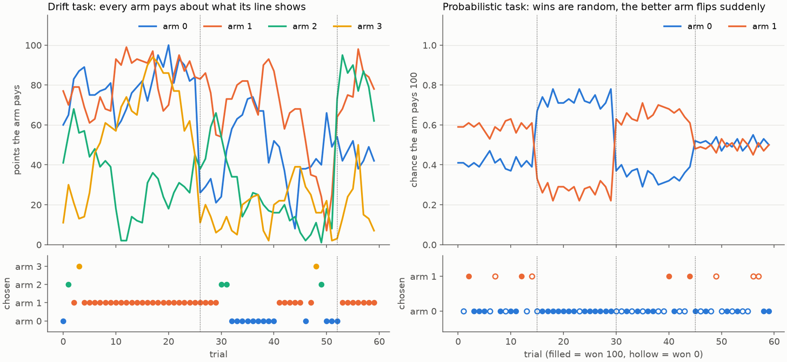</a>
  <figcaption><strong>One person's data.</strong> Top panels show what each arm is worth. Bottom panels show the arm chosen on each trial. Dotted lines are block changes, and hollow dots on the right are zero outcomes.</figcaption>
</figure>

The whole group shows three patterns. Accuracy falls to about chance at a block change and recovers within about 5 to 10 trials, so people clearly adapt. The size of the last payoff strongly drives repeating a choice. In the drift tasks, people repeat 13% of the time after about 10 points and 91% of the time after about 90 points. Median accuracy is 0.53 to 0.55 in drift and 0.64 to 0.66 in the probabilistic tasks, but chance is 0.25 and 0.5 respectively, so you cannot compare those numbers directly. Cued and uncued versions look very similar throughout.

<figure class="ft-fig">
  <a class="ir-link" href="/assets/images/interp-disrnn/group.png">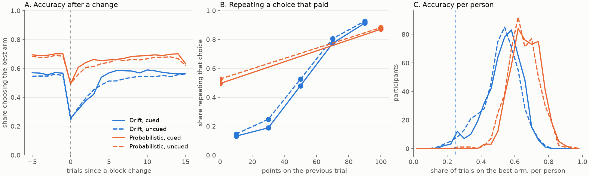</a>
  <figcaption><strong>What all 487 participants do.</strong> (A) Accuracy around a block change. (B) How often people repeat a choice, by the points it just paid. (C) Accuracy per person, with chance marked by the vertical lines.</figcaption>
</figure>

## What is a disentangled RNN?

The model takes the arm chosen, the points and the cue. It passes them through five latentsThe model's internal memory variables, which carry information from one trial to the next., which act as its memory, and it outputs the probability of each next choice. Each latent updates the same way:

$$ \text{new} = (1 - w) \times \text{old} + w \times \text{target} $$

A small network reads the inputs and the previous latents, and it sets both the target and \\(w\\). So \\(w\\) is that latent's learning rate on that trial, and it can change from trial to trial. That property is why this model suits my question.

The disentangling comes from a bottleneck. Every connection pays a penalty for carrying information, so a higher penalty leaves fewer and simpler latents.

<figure class="ft-fig">
  

  <figcaption><strong>The bottleneck.</strong> Slide the penalty. The diagram is schematic, and which latents close differs between fits. The penalties, mean open latents and held-out likelihoods are measured across the original fits.</figcaption>
</figure>

The original fits have 30 copies per penalty, with the same starting weights and different participants. The best fit has a penalty of 0.005 and three active latents, and that is where I started. On this fit, I set latent 3 to different values, left everything else as observed, and measured latent 2's learning rate. Moving latent 3 from its typical off value to its typical on value raises that learning rate from 0.45 to 0.72.

<figure class="ft-fig">
  <a class="ir-link" href="/assets/images/interp-disrnn/latent3-rate.png">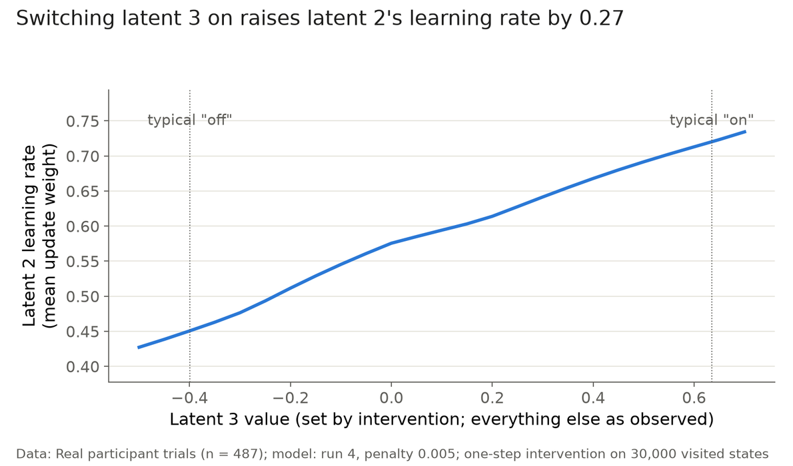</a>
  <figcaption><strong>The result that caught our attention.</strong> Latent 3 seemed to switch latent 2's learning rate.</figcaption>
</figure>

That looks like a dynamic learning rate inside the model. I wanted to know what turns it on and off, whether people actually do this, and whether every fit finds it.

## What is latent 3 doing?

To find out what the latents track, I predicted each one from simple behavioral variables and tested on held-out participants. Here, \\(R^2\\) is the share of the latent's variation explained.

<strong>Latent 1 is essentially a running tally of arm 2 and 3 choices</strong> over about the last 3 to 5 trials, with \\(R^2 = 0.90\\). Latent 2 is a reward-weighted trace favoring arm 0 over arm 1, which looks like win-stay, with \\(R^2 = 0.51\\), so it is less fully explained.

<figure class="ft-fig">
  <a class="ir-link" href="/assets/images/interp-disrnn/latents-1-2.png">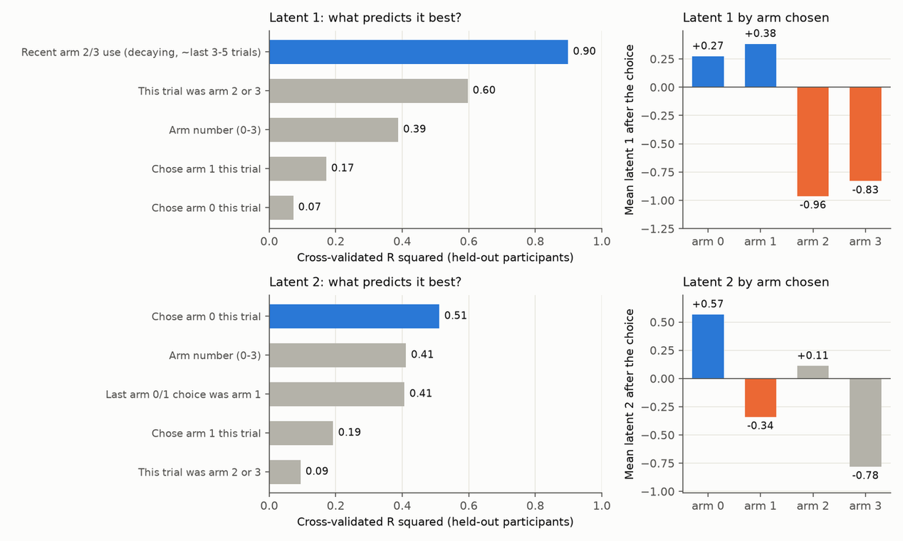</a>
  <figcaption><strong>Latents 1 and 2 track ordinary things.</strong> Left: cross-validated \(R^2\) for each predictor. Right: each latent's mean value by the arm chosen.</figcaption>
</figure>

Latent 3 is different. Across all real trials it takes essentially two values. It flips when latent 1 falls below about −0.2, and that relationship predicts latent 3 with a held-out \\(R^2\\) of 0.99. So latent 3 is a threshold on the running tally of arm 2 and 3 use.

<figure class="ft-fig">
  <a class="ir-link" href="/assets/images/interp-disrnn/latent3-bimodal.png">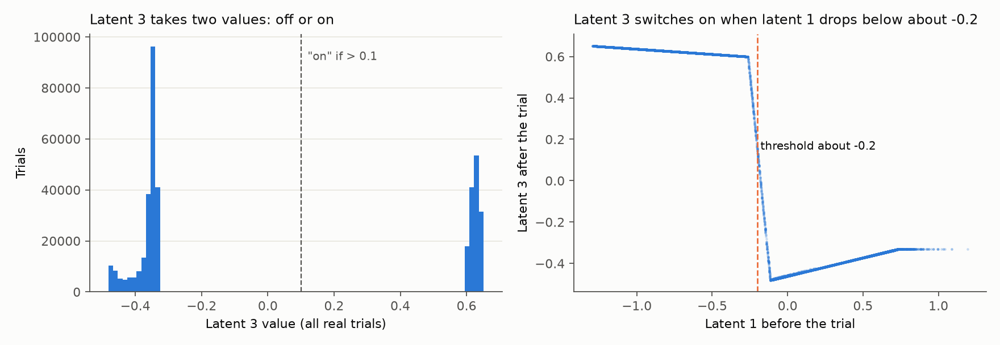</a>
  <figcaption><strong>Latent 3 is an on/off switch that reads latent 1.</strong></figcaption>
</figure>

To see what drives it directly, I fed the model synthetic inputs, with the same choice and the same points repeated on every trial, and counted the trials until latent 3 flipped. You can replay that result below.

<figure class="ft-fig">
  

  <figcaption><strong>Drive the switch yourself.</strong> Pick an arm and points, and click the arm again to add trials. This figure looks up the table measured on the best fit, shown below, and does not run the network. The table repeated one input, so changing your input here restarts the count.</figcaption>
</figure>

<figure class="ft-fig">
  <a class="ir-link" href="/assets/images/interp-disrnn/latent3-synthetic.png">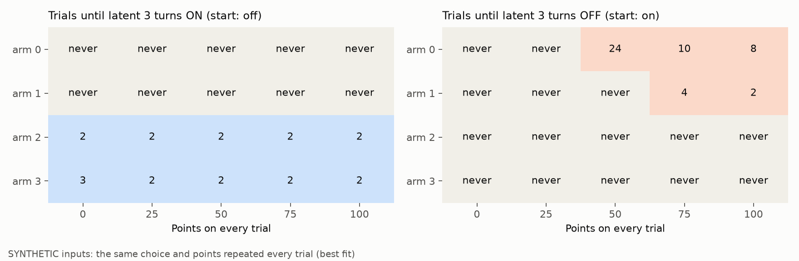</a>
  <figcaption><strong>Choosing arm 2 or 3 turns latent 3 on at any payoff.</strong> Arms 0 and 1 never turn it on. The only ways to turn it off are arm 0 at 50 points or more and arm 1 at 75 points or more.</figcaption>
</figure>

Turning on has nothing to do with the outcome. It depends on which arm you picked, with no role for surprise or reward. That was my first hint that latent 3 may have little to do with learning from outcomes.

The reason appears when you split by task. Latent 3 is on in about 75% of drift trials and about 1% of probabilistic trials, because arms 2 and 3 only exist in the drift tasks. People choose those arms on about half of drift choices. A latent that reads arm 2 and 3 use is effectively reading which family of task you are in.

<figure class="ft-fig">
  <a class="ir-link" href="/assets/images/interp-disrnn/latent3-task.png">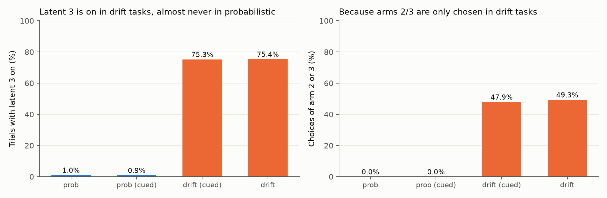</a>
  <figcaption><strong>The switch tracks the task type.</strong></figcaption>
</figure>

For a direct test, I edited the fitted model in two ways, with nothing retrained, and scored how well it predicts people's choices. These scores use all 487 participants, so they are within-model comparisons and not held-out scores. Holding latent 3 off drops drift predictions from 0.397 to 0.231, which is below the chance level of 0.25, so latent 3 clearly matters to the model. Replacing latent 3 with a fixed task label, on in drift and off in probabilistic, gives 0.395 against 0.397. <strong>Nearly everything latent 3 contributes is knowing the task</strong>, and its trial-by-trial timing adds very little.

<figure class="ft-fig">
  <a class="ir-link" href="/assets/images/interp-disrnn/latent3-edit.png">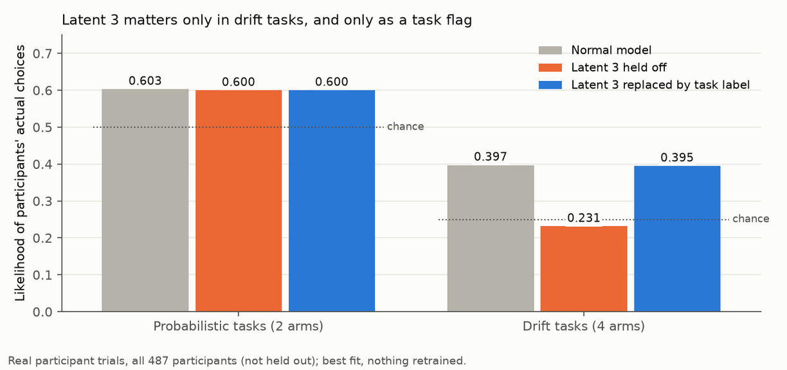</a>
  <figcaption><strong>A fixed task label replaces latent 3 almost perfectly.</strong></figcaption>
</figure>

So latent 3 comes from the model recognising the task from the arms people choose, and I do not count it as evidence of a learning mechanism. That conclusion is about the model, though. It leaves open whether people change their learning rate.

## Do people themselves learn faster?

If the switch reflected something real in people, they should be more sensitive to outcomes when it would be on. This test has no network in it. I plotted how likely people are to repeat an arm after low and after high points, on a log-oddsThe logarithm of the probability divided by one minus the probability. On this scale, a steeper line means a stronger effect of points. scale, split by recent arm 2 or 3 use.

People stay less often after recently using those arms, so the orange line sits lower. The slope is the part that answers my question, and the slopes match, with a rise of 1.99 against 1.90. The regression agrees. Points have a clear effect of +1.26, and the extra effect after recent arm 2 or 3 use is +0.02, with a confidence interval spanning zero.

<figure class="ft-fig">
  <a class="ir-link" href="/assets/images/interp-disrnn/people-slopes.png">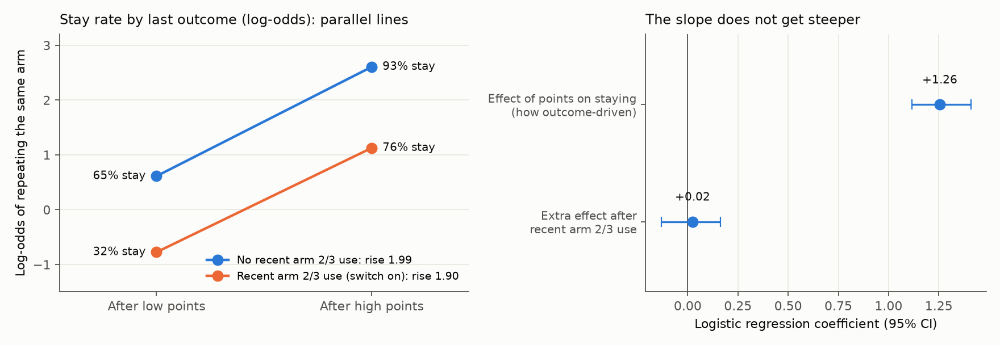</a>
  <figcaption><strong>People do not learn faster after using arms 2 and 3.</strong> A steeper orange line would have meant a higher learning rate when the switch would be on.</figcaption>
</figure>

I also fitted a two-rate model directly to 458 people, with one learning rate after arm 2 or 3 use and one otherwise. It gives medians of 0.80 and 0.83, with \\(p = 0.86\\). So I see no sign of the speed-up the latent suggested.

That tested one specific switch, so I also tested the classic dynamic rule, Pearce-HallA rule in which the learning rate rises after surprising outcomes and falls after expected ones (Pearce and Hall, 1980)., where the learning rate follows surprise (<a href="#ref-pearce1980">Pearce and Hall, 1980</a>). I scored each participant on a task the rule was not fitted to. On average, Pearce-Hall is worse than ordinary Q-learningA simple rule that keeps one value per option and moves it toward each outcome at a fixed learning rate. by 0.009 natsThe negative log of the probability the model gave to the actual choice. Lower is better. per choice in the probabilistic tasks and 0.039 in drift. It wins for only 31% and 21% of people.

<figure class="ft-fig">
  <a class="ir-link" href="/assets/images/interp-disrnn/pearce-hall.png">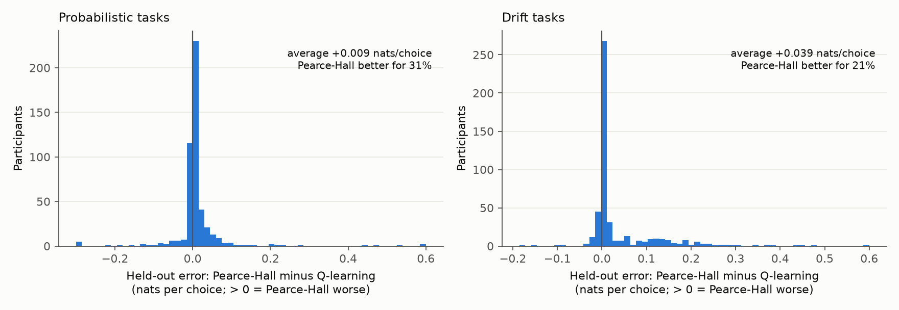</a>
  <figcaption><strong>Learning rate does not follow surprise.</strong> Values to the right of zero mean Pearce-Hall predicts worse than Q-learning.</figcaption>
</figure>

I did find one difference in learning rate. Within a person, it is slightly higher in drift than in probabilistic tasks, by a median of 0.03. That difference is small, and it sits between tasks with no trial-by-trial change.

## Does every fit find the switch?

Using a causal scan, I asked whether one latent scales another's learning rate. In Jes's fits, 16 of 30 do, but only 2 of 30 do it as an on/off switch. In my refits at the same settings, 8 of 30 do, none of them on/off, and none of my 3 refits with one-hotAn input coding that gives each arm its own input line. The scalar fits give the arm as one number. arm inputs show it. A task-flag latent like latent 3 appears in 5 of Jes's 30 fits and in none of mine, and only the best fit has this specific arm 2 and 3 switch. So the switch is rare, and it depends on how the fit was run. I do not yet know what explains the difference between Jes's fits and my refits.

<figure class="ft-fig">
  <a class="ir-link" href="/assets/images/interp-disrnn/causal-scan.png">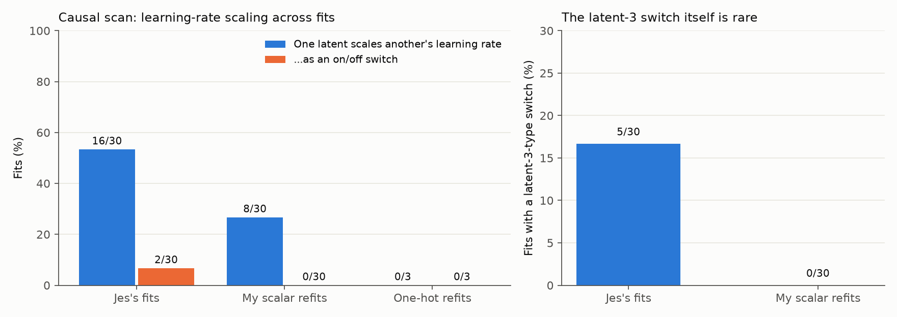</a>
  <figcaption><strong>The latent 3 switch is rare across fits.</strong></figcaption>
</figure>

Latent labels are not comparable between fits, because latent 3 in one fit may not be latent 3 in another. So I used representational similarity analysisRSA compares two systems by how they relate pairs of inputs, so their internal variables do not need to be matched one to one., which does not need matched latents. I took the same 1,000 trials from 60 real participants, 250 per task. For each fit, I built a map of how different its internal state is for every pair of trials. Then I compared the maps of two fits using \\(R^2\\), where 1 is identical and 0 is unrelated. This consistency measure comes from <a href="#ref-mehrer2020">Mehrer et al. (2020)</a>.

Fits with new starting weights agree less than fits with new participants, at 0.45 against 0.60. Linear CKACentered kernel alignment, a different measure of similarity between representations. shows the same ordering. Fits agree most on choice probabilities, at about 0.65 to 0.75. They agree less on latents, and least on learning rates, at under 0.2.

<figure class="ft-fig">
  <a class="ir-link" href="/assets/images/interp-disrnn/rsa.png">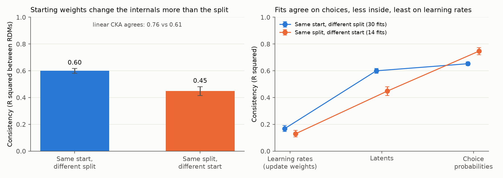</a>
  <figcaption><strong>Fits agree on choices and disagree on learning rates.</strong></figcaption>
</figure>

This result matters for my question. <strong>Learning rates are what we most wanted to read from these models, and they are the least reproducible part.</strong> Fits can predict similar choices with quite different internals.

A stronger penalty does not solve this. Going from a penalty of 0.001 to 0.005 raises consistency from 0.47 to 0.60, and held-out likelihood falls from 0.508 to 0.442. At very high penalties fits are almost identical, with about one open latent and much worse prediction. So fits become consistent partly by becoming simple.

<figure class="ft-fig">
  <a class="ir-link" href="/assets/images/interp-disrnn/penalty.png">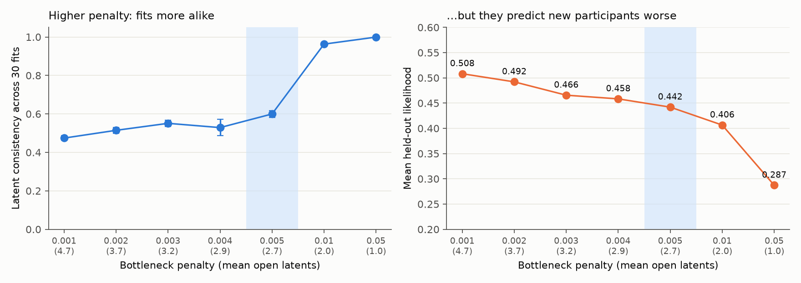</a>
  <figcaption><strong>A stronger penalty makes fits alike but worse.</strong> The shaded region is the setting of the best fit.</figcaption>
</figure>

## Can the method recover a known answer?

This is the part I think matters most. I built simulated players and ran them on participants' own sessions. One player has a planted switch, where the learning rate goes from 0.2 to 0.6 after recent arm 2 or 3 use. The other has no switch at all. Because I wrote the players, I know the right answer.

The disentangled RNN recovered the planted switch in 0 of 18 fits, across six settings with three seeds each. At Jes's settings, on the player with no switch, it invented a task-type latent. So <strong>it can miss a switch that is there, and it can produce one that is not</strong>.

The simple two-rate test does much better on the same players. Toggle between them below.

<figure class="ft-fig">
  

  <figcaption><strong>One test, three populations.</strong> The planted and no-switch values use the first 150 simulated sessions of each player, and the people values are medians across 458 participants. The test that finds the planted switch finds nothing in people. So a switch in a fit is not evidence of a switch in people, and a validated behavioral test can tell the two apart.</figcaption>
</figure>

I then wanted to know why the network misses the switch, and these results are preliminary. With the bottleneck penalty removed completely, the network still misses it, reaching a held-out likelihood of 0.466 to 0.474 when the true player gets 0.486. Training much longer does not appear to help, though only one of the three long fits finished, at 0.474. A GRUA standard recurrent network with no bottleneck, so its internals are free and hard to read. with 32 units misses it too, at about 0.463. Both networks also fall short on the plain player, which has no switch to find. That player scores 0.475, and the long disentangled RNN fits reach 0.464 to 0.466.

So the limit does not look specific to the disentangled RNN. My leading suspect is the amount of data, at about 243 training sessions, but I have not separated that from the inputs or the optimizer yet. The GRU's training likelihood is about 0.017 above its held-out likelihood, which suggests overfitting.

A larger network changes how I read the human fits.

<table class="ir-table">
  <thead><tr><th>Fits to people</th><th>Held-out likelihood</th><th>Switch-like latent?</th></tr></thead>
  <tbody>
    <tr><td>Jes's best fit</td><td>0.486</td><td>Yes (latent 3)</td></tr>
    <tr><td>My refits at Jes's settings (3+3 units, penalty 0.005)</td><td>0.451 to 0.492</td><td>No</td></tr>
    <tr><td>Larger network (16+16 units, penalty 0.001), 3 seeds</td><td>0.546 to 0.551</td><td>No</td></tr>
  </tbody>
</table>

The larger network was also the only setting where fits to the no-switch player grew no fake mechanisms, with 3 of 3 clean. So what it does find is more believable. It proposes a graded sense of task type, and continued revision of arms 2 and 3 while people are on arms 0 and 1.

This setting also missed the planted switch, so its positive findings are more trustworthy than its negative ones. On its own, the absence of a switch in this fit does not show that people have none. That evidence comes from the behavioral tests. The human fits also show some latent's update weight rising by about 0.22 to 0.25 after recent arm 2 or 3 use. That need not conflict with the two-rate test, because a latent's update weight is different from the chosen arm's learning rate, and I have not finished testing it.

## Do people revise options they aren't choosing?

The network's proposal is something I can test directly. If people revise options they are not choosing, the value of an unchosen option should fade. So I added a decay term, \\(d\\), to Q-learning and fitted it per person in the drift tasks.

The test passes validation. On simulated players with no decay it recovers 0.003, and on players with a true decay of 0.15 it recovers 0.141. In people, the median is about 0.16 per trial, and \\(d\\) is above 0.02 in 89% of the 487. Here, <strong>the network suggested something, and the behavioral test then supported it</strong>.

<figure class="ft-fig">
  <a class="ir-link" href="/assets/images/interp-disrnn/decay.png">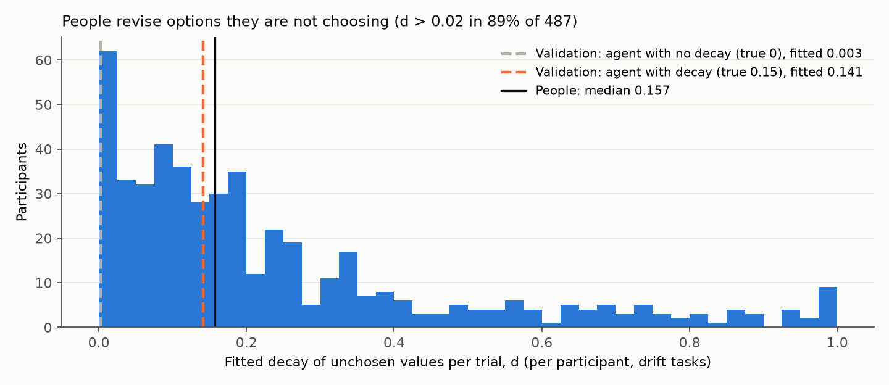</a>
  <figcaption><strong>People revise options they are not choosing.</strong></figcaption>
</figure>

## Which learning rule predicts best?

Next I compared rules head to head. I fitted each rule on one task and scored it on the other, so it predicts a task it has not seen. I checked first that each simulated rule is recovered as the best model for its own players, because the comparison means little if it cannot tell these rules apart.

In people, Q-learning plus unchosen decay comes out best in the drift tasks. Surprise-driven, uncertainty-driven and context-gated rates all lose. Win/loss asymmetry with decay ties it, at 0.8133 against 0.8129. In that model, the learning rate from losses is higher than from wins, at 0.89 against 0.60, in 76% of people.

<figure class="ft-fig">
  <a class="ir-link" href="/assets/images/interp-disrnn/rules-drift.png">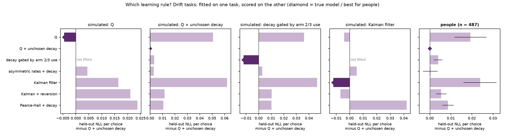</a>
  <figcaption><strong>Q plus unchosen decay predicts new drift tasks best.</strong> Bars show held-out loss relative to Q plus unchosen decay, so longer bars to the right are worse. The first four panels are simulated players, with a diamond on the true model. The last panel is people. Click to enlarge.</figcaption>
</figure>

The probabilistic tasks give the same winner, at 0.5039, with a median decay of 0.30 per trial. A person's decay also correlates across the two task families, though only weakly, with \\(\rho = 0.13\\) and \\(p = 0.003\\). One caution applies here. On simulated decay players, the test gives a false asymmetry, so a win/loss difference on its own needs care.

<figure class="ft-fig">
  <a class="ir-link" href="/assets/images/interp-disrnn/rules-prob.png">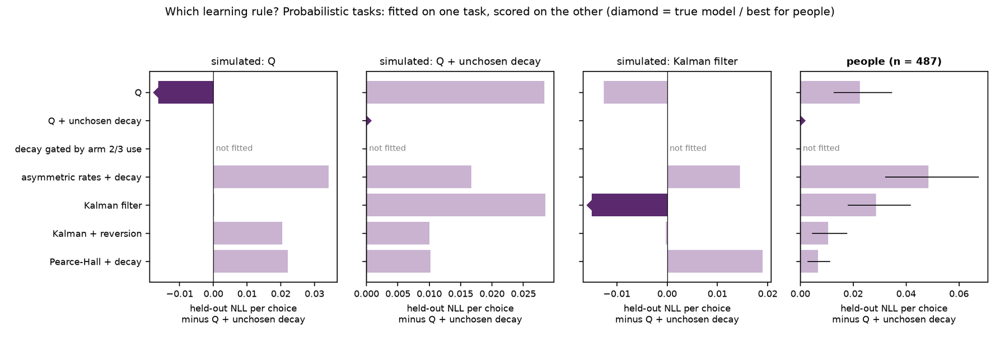</a>
  <figcaption><strong>The same rule wins in the probabilistic tasks.</strong></figcaption>
</figure>

## Does any of this hold in other data?

I added two public datasets to see what generalizes, and I validated each one before touching the real comparison. <a href="#ref-bahrami2020">Bahrami and Navajas (2020)</a> shared data from a four-armed drift task, in the paradigm of <a href="#ref-daw2006">Daw et al. (2006)</a>. <a href="#ref-beron2022">Beron et al. (2022)</a> shared data from mice on a two-armed task with sudden reversals.

<table class="ir-table">
  <thead><tr><th></th><th>Bahrami and Navajas</th><th>Beron et al. 2022</th></tr></thead>
  <tbody>
    <tr><td>Participants</td><td>965 people, 150 trials</td><td>6 mice, 54 units of 10 sessions</td></tr>
    <tr><td>Task</td><td>4 arms, gradual drift</td><td>2 arms, sudden reversals</td></tr>
    <tr><td>Held out</td><td>Alternating 25-trial blocks</td><td>Alternating sessions</td></tr>
    <tr><td>Rules recovered</td><td>Q, decay, Kalman (narrowly)</td><td>Q, decay, Kalman, asymmetry</td></tr>
    <tr><td>Planted asymmetry</td><td>In parameters (72%), not held out</td><td>Found held out (100%)</td></tr>
  </tbody>
</table>

The last row taught me something. In short sessions, a held-out tie does not rule asymmetry out, and that applies to the tie in our drift tasks. Fitting the wrong rule can also fake an asymmetry. KalmanA rule that tracks its own uncertainty about each arm, and learns faster when that uncertainty is high. players read as a win rate of 0.42 and a loss rate of 0.14. So asymmetry needs care from both directions.

Here is the comparison across all four task sets. Each bar is held-out loss above the best model for that dataset.

<figure class="ft-fig">
  <a class="ir-link" href="/assets/images/interp-disrnn/datasets.png">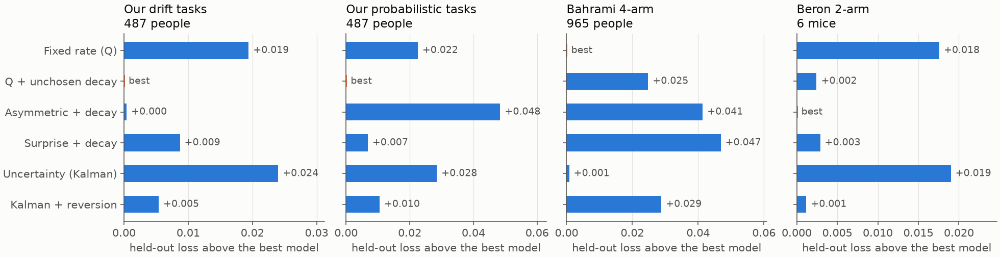</a>
  <figcaption><strong>No dynamic rule wins outright in any dataset.</strong> Two come close.</figcaption>
</figure>

In our drift and probabilistic tasks, Q plus unchosen decay is best. In Bahrami, plain Q is best, Kalman ties it with \\(p = 0.055\\), and surprise-driven learning is worst. In the mice, asymmetric rates plus decay is best, with Kalman plus reversion just behind by 0.001. So I would read "no dynamic rule wins" with care. Which dynamic rule comes close changes between datasets, and surprise-driven learning does not win in people anywhere.

<table class="ir-table">
  <thead><tr><th></th><th>Our 487 people</th><th>Bahrami, 965 people</th><th>Beron, 6 mice</th></tr></thead>
  <tbody>
    <tr><td>Best static rule beats dynamic rates?</td><td>Yes</td><td>Yes, tied with Kalman</td><td>Yes, Kalman + reversion close</td></tr>
    <tr><td>Unchosen decay helps?</td><td>Yes (d 0.17 to 0.30)</td><td>No, because Q wins for 66% (d about 0.086)</td><td>Yes (d about 0.8)</td></tr>
    <tr><td>Learning rate, loss vs win</td><td>Loss above win in 76% (drift)</td><td>Loss above win in 73% (p = 8 × 10−55)</td><td>Win above loss in all 6 mice (provisional)</td></tr>
  </tbody>
</table>

What repeats in people is that no dynamic rate clearly wins, and that people seem to learn more from losses. Unchosen decay does not repeat, so it is not universal. The mouse asymmetry is provisional, because my check for a false asymmetry in their parameter range is still running.

## How sure am I?

I am confident that latent 3 tracks task type in this fit, since a fixed task label replaces it.

I found no evidence of a dynamic learning rate in our 487 participants. The arm 2 and 3 switch fails a test that demonstrably works, and surprise-driven and uncertainty-driven rules predict worse. That is not proof that no dynamic rate exists, because a form I have not tested could still be there.

Fits differ inside, and learning rates agree least across fits, so I would not read a mechanism from a single fit. Q plus unchosen decay wins held out in our tasks and does not win in the Bahrami data. The finding that people learn more from losses repeats in two human datasets, but I hold it loosely, because asymmetry can be faked and it can be missed.

The practical message is to <strong>treat a mechanism read from a disentangled RNN as a hypothesis, and check it with a targeted test that has been validated on known answers</strong>. The network is still useful in that role, since it pointed me to unchosen decay.

## What's next?

I am finishing the cross-dataset validations, including the check on the mouse asymmetry. I am also running a benchmark that plants known rules in simulated players and scores each method on recovering them. At the time of writing, 55 of 156 jobs are done, so these numbers are interim. On the finished Bahrami simulations, disentangled RNNs claim a dynamic rate in 62 to 67% of fits when none is planted, and in only 28 to 44% when one is. Requiring agreement across seeds and a theory test removes the false claims. It also keeps at most 28% of the true ones, and the theory test does nearly all of that filtering.

The open question is whether we need a new architecture. My answer right now is not yet. A more flexible network does no better, so flexibility is not the fix. The next test is whether about four times as many simulated sessions lets the networks recover the switch. If data is the limit, a more constrained model, or one that shares information across people, could be worth proposing, because we cannot easily get more participants. If data is not the limit, I would test the inputs and the optimizer next.

I'd love to hear what you think, especially about that last question. Thank you to Jes and Maria for their mentorship!

## References

<ol class="ft-refs">
  <li id="ref-miller2023">Miller, K. J., Eckstein, M., Botvinick, M. M., and Kurth-Nelson, Z. (2023). Cognitive model discovery via disentangled RNNs. <em>NeurIPS</em>.</li>
  <li id="ref-pearce1980">Pearce, J. M., and Hall, G. (1980). A model for Pavlovian learning: variations in the effectiveness of conditioned but not of unconditioned stimuli. <em>Psychological Review</em>, 87, 532–552.</li>
  <li id="ref-mehrer2020">Mehrer, J., Spoerer, C. J., Kriegeskorte, N., and Kietzmann, T. C. (2020). Individual differences among deep neural network models. <em>Nature Communications</em>, 11, 5725.</li>
  <li id="ref-bahrami2020">Bahrami, B., and Navajas, J. (2020). 4 Arm Bandit Task Dataset. Open Science Framework. <a href="https://osf.io/f3t2a/">osf.io/f3t2a</a></li>
  <li id="ref-daw2006">Daw, N. D., O'Doherty, J. P., Dayan, P., Seymour, B., and Dolan, R. J. (2006). Cortical substrates for exploratory decisions in humans. <em>Nature</em>, 441, 876–879.</li>
  <li id="ref-beron2022">Beron, C. C., Neufeld, S. Q., Linderman, S. W., and Sabatini, B. L. (2022). Mice exhibit stochastic and efficient action switching during probabilistic decision making. <em>PNAS</em>, 119, e2113961119.</li>
</ol>

